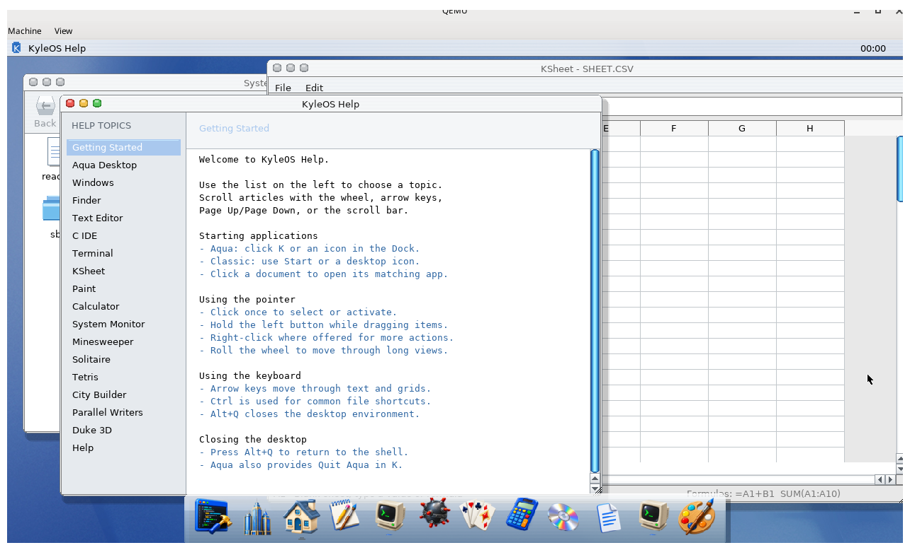

# KyleOS

KyleOS is a hobby x86-64 operating system with a small Unix-like userspace.
It boots directly in QEMU, uses a FAT32 disk image for persistent files, and
has a framebuffer-capable DoomGeneric port.

## Contents

- [What is included](#what-is-included)
- [Kernel and platform](#kernel-and-platform)
- [Desktop and GUI](#desktop-and-gui)
- [Included programs](#included-programs)
- [Technical feature matrix](#technical-feature-matrix)
- [Build and boot](#build-and-boot)
- [Testing and diagnostics](#testing-and-diagnostics)
- [Source layout](#current-source-layout)
- [Limitations](#current-limitations)

## What is included

KyleOS is a bootable system rather than a userspace demo. The image combines a
small preemptive kernel, a FAT32-backed root filesystem, a Unix-like command
environment, and two window-manager shells sharing the same GUI applications.
It runs in QEMU and on compatible x86 hardware with legacy BIOS and PS/2 input.
The GUI userspace requires an SSE4.2-capable CPU; the default QEMU profile uses
`-cpu max` so those instructions are available.

## Kernel and platform

- x86-64 long mode with 32-bit bootstrap support and a framebuffer console.
- Demand-zero heap and stack paging, lazy file-backed ELF paging, physical-page
  allocation, and a checked first-fit kernel heap.
- Preemptive round-robin scheduling, user processes, `fork`, copy-on-write,
  `exec`, `wait`, file descriptors, pipes, `poll`, and process reaping.
- FAT32 VFS with directories, file creation/truncation, seek, sizes, removal,
  and separate RAM filesystems at `/dev` and `/tmp`.
- PCI device discovery for IDE and display hardware. Runtime disk I/O uses
  PCI IDE bus-master DMA on supported compatibility-mode controllers, with
  IRQ completion, bounded timeouts, and automatic PIO fallback for reads.
- `/dev/console`, four switchable virtual terminals, `/dev/ttyS0`,
  `/dev/null`, `/dev/zero`, `/dev/kmsg`, UART/serial input, keyboard input,
  PS/2 mouse input, and raw-console mode.
- User-mode page and general-protection faults terminate the offending process;
  kernel faults retain register-dump diagnostics.

The [PCI IDE DMA engineering report](docs/pci-ide-dma-report.html) documents
the controller setup, PRDT and bounce-buffer design, recovery policy, Aqua
latency investigation, verification results, and current hardware boundaries.

## Desktop and GUI

`/bin/kuid` is the shared compositor and window server. It owns the framebuffer,
input routing, focus, window geometry, display-command validation, and process
lifecycle. Applications communicate through the versioned KUI event/response
protocol over pipes.

- `desktop`: classic taskbar and Start-menu shell.
- `aqua`: Aqua-inspired menu bar, Dock, traffic-light controls, and glass-style
  scrollbars. Clicking its clock opens a month calendar; selected dates can be
  copied in short, ISO, or long form through the date context menu.
- Shared KUI menus, text selection, file dialogs, Save As confirmation, wheel
  scrolling, repeating scrollbar arrows, and window resize handling.
- Applications include Finder, Notes, Writer, Text Editor, C IDE, Terminal,
  KSheet, Paint, Control Center, Help, System Monitor, games, and parallel-writer
  demonstrations.

See the [GUI architecture guide](docs/gui-architecture.html),
[Markdown architecture notes](docs/gui-architecture.md), the
[KUI/KUID protocol map](reports/kuid-protocol.html),
[project growth graph](docs/project-growth.html), and the
[Aqua desktop screenshot](docs/kyleos-aqua-desktop.png).

## Included programs

### Core commands

`ls`, `cat`, `cp`, `mv`, `rm`, `mkdir`, `rmdir`, `grep`, `wc`, `head`, `tail`,
`ps`, `kill`, `ed`, `kedit`, `sh`, and the filesystem/process regression
tools.

### GUI applications

Finder, Notes, Writer, Text Editor, C IDE, Terminal, KSheet spreadsheet,
Paint, Control Center, Help, Calculator, System Monitor, Minesweeper,
Solitaire, Tetris, KyleFPS, KyleKart, Flappy Bird, City Builder, Parallel
Writers, and the Aqua/Win95 shell demos.

### Optional extras

DoomGeneric, Quake, Duke Nukem 3D, Lua 5.4.4, and the native TinyCC compiler
are built and installed by their respective image targets.

## Technical feature matrix

- x86-64 long mode, demand-zero heap and stack paging, lazy file-backed ELF
  executable paging, physical-memory allocation, and a 16-byte-aligned
  first-fit kernel heap with block splitting, adjacent-block coalescing, and
  corruption checks.
- Preemptive round-robin scheduling with user processes, copy-on-write
  `fork`, demand-paged `exec`, `wait`, file descriptors, and standard
  input/output/error.
- A userspace `/sbin/init` running as PID 1, with orphan adoption, child
  reaping, four supervised virtual-console shells, and a supervised COM1
  serial shell.
- FAT32 root filesystem plus separate RAM filesystems at `/dev` and `/tmp`.
- PCI IDE bus-master DMA for runtime reads and writes, using a 32 KiB,
  64-KiB-boundary-safe bounce buffer and physical PRDT. Fast transfers complete
  from BMIDE status; slower transfers sleep for IRQ 14/15 with a two-second
  timeout. Failed reads fall back to PIO, while uncertain writes fail closed.
- `/dev/console`, `/dev/null`, `/dev/zero`, and a writable 64 KiB kernel-log
  ring at `/dev/kmsg` with monotonic timestamps.
- Directories, file and empty-directory removal, 8.3-safe rename,
  case-insensitive FAT lookup, truncate/append opens, shared open-file
  positions across `fork`, seek, file sizes, and a simple VFS.
- Pipes and shell redirection, including chained pipelines, repeat loops,
  `*`/`?` wildcard expansion, and `$?` reporting for the previous foreground
  command.
- POSIX-style signal handlers, masks, pending signals, stop/continue state,
  signal-aware wait statuses, process groups, sessions, and terminal-aware
  shell job control with `&`, `jobs`, `fg`, `bg`, and job-aware `kill`.
- PTY line discipline with canonical input, echo, configurable control
  characters, foreground-process-group ownership, and terminal-generated
  Ctrl+C, Ctrl+\, and Ctrl+Z signals.
- Consistent console and PTY key handling for Tab/Shift+Tab, Caps Lock,
  Home/End, Insert/Delete, Page Up/Down, arrows, and F1 through F12. The KUI
  terminal emits the corresponding VT100/xterm sequences for applications.
- Native `poll(2)` through Newlib for up to 64 descriptors, with event-driven
  pipe wakeups, finite or infinite timeouts, and regular-file readiness.
- In-image filesystem, heap, and user-fault regression suites, plus a single
  integrated runner: `nushell < /tests/all.sh`.
- User-mode page and general-protection faults terminate only the offending
  process; kernel-mode faults retain the register-dump panic path.
- Four virtual consoles selected with Alt+F1 through Alt+F4, a separate COM1
  login at `/dev/ttyS0`, keyboard input, raw-console mode, and a 1280x720
  framebuffer on the supported BGA display path.
- PS/2 mouse input and a shared userspace compositor at `/bin/kuid`. Launch
  `/bin/desktop` for the classic taskbar/Start environment or `/bin/aqua` for
  the Aqua-inspired menu bar, Dock, and traffic-light window controls. Both
  environments run the same KUI application processes and compositor.
- Boots on compatible physical x86 hardware through legacy BIOS, with PS/2
  keyboard and mouse support in addition to QEMU.
- Small userspace: `ls`, `cat`, `cp`, `rm`, `mkdir`, `grep`, `wc`, `head`,
  `tail`, `mv`, `ed`, `kedit`, and more.
- Incrementally rendered ASCII Breakout at `/bin/breakout` (`a`/`d` move,
  `q` quits), with input/render timing independent from ball movement.
- DoomGeneric as optional fullscreen (`/usr/bin/doom`) and separate Aqua
  windowed (`/usr/bin/doom-aqua`) extras.
- Original Quake's C software renderer as optional silent fullscreen
  (`/usr/bin/quake`) and separate keyboard-and-mouse Aqua windowed
  (`/usr/bin/quake-aqua`) extras.
- Chocolate Duke3D's Build software renderer as an optional silent,
  keyboard-only extra, installed at `/usr/bin/duke3d`.
- Lua 5.4.4 as an optional Newlib-built extra, installed at `/usr/bin/lua`.
- A native x86-64 TinyCC at `/bin/cc`, including headers, static Newlib,
  compiler sources, and a tested stage-2/stage-3 self-bootstrap path.

### KUI desktop environments

`kuid` owns the framebuffer, input routing, application surfaces, focus,
authoritative window geometry, and command validation. It starts one privileged
shell process and exchanges versioned state, drawing commands, hit consumption,
and shell actions over pipes. `win95-shell` owns the classic taskbar and Start
menu; `aqua-shell` owns the top menu bar and Dock. Window decorations use the
metrics and style supplied by that shell.

Applications receive the shell style in their normal KUI event stream, so the
same Finder, editor, terminal, games, dialogs, and menus render consistently in
either environment. The compositor polls the shell and every application pipe
as one descriptor set, while bounded poll-driven response reads prevent a
disconnected or stalled client from blocking the display server forever.

### GUI architecture

The detailed GUI architecture, event/rendering flows, Save As path, and source
map are documented in [the HTML architecture guide](docs/gui-architecture.html)
and [the Markdown version](docs/gui-architecture.md).



This live QEMU capture shows the Aqua composition with KSheet, Help, Finder,
and the Dock running together. The shell owns the menu bar, window placement,
and Dock while applications render through the shared KUI protocol and widget
library. The [architecture preview](docs/gui-aqua-overview.svg) provides a
clean diagrammatic overview as well.

From the KyleOS console, start either environment with:

```sh
desktop
aqua
```

## Prerequisites

On a Debian/Ubuntu-style host, install the host tools:

```bash
sudo apt install build-essential gcc-13 nasm binutils qemu-system-x86 \
  dosfstools kpartx util-linux imagemagick python3-pil fontconfig \
  fonts-dejavu-core
```

You also need `sudo` access for creating, mapping, formatting, and mounting
the generated FAT image.

Initialize the tracked extras after cloning:

```bash
git submodule update --init --recursive
```

## Current source layout

The kernel, userspace, Newlib sources, and image tooling all live in this
repository. Copy the example configuration only when overriding the defaults:

```bash
cp config.mk.example config.mk
```

The default configuration uses these repository-local trees:

```text
userspace/core
userspace/programs
external/newlib
build/toolchain/newlib
```

The repository-local dependency policy is intentional: source dependencies are
checked in under `userspace/` and `external/`, while compiler output, sysroots,
userland staging files, and disk images are generated only under `build/`.
No build target should require `/tmp/z` or a sibling checkout.

See [`userspace/README.md`](userspace/README.md) for the ownership boundary
between the core userspace tree and the additional programs tree.

`config.mk` is ignored by Git. The configured Newlib build tree is generated
under `build/toolchain/newlib`; generated libraries and headers are installed
under `build/sysroot`.

## Build and boot

Generated output is kept under `build/` and is not tracked.

```bash
make toolchain      # rebuild/install Newlib into the configured sysroot
make userland       # build and stage the base /bin programs
make image          # create build/image/test-hd.img if it is absent
make test           # build the kernel and boot the existing image
```

Use `make image-reset` to intentionally recreate the image.  It destroys all
files stored in that generated image, including savegames and test files.
Normal `make test` preserves the existing image.

The image scripts clean up kpartx mappings on failure.  If an image creation
was interrupted, rerun `make image`; incomplete images are recreated rather
than treated as valid.

## Filesystem layout

New generated images use this layout:

```text
/
├── bin/                 # standard KyleOS tools and the boot shell
│   ├── nushell
│   ├── ls
│   ├── grep
│   └── ...
├── sbin/
│   └── init             # PID 1 and console supervisor
├── dev/                 # RAM filesystem
│   ├── console
│   ├── tty1 ... tty4       # Alt+F1 ... Alt+F4 virtual terminals
│   ├── ttyS0               # COM1 serial terminal
│   ├── null
│   ├── zero
│   └── kmsg
├── tmp/                 # writable RAM filesystem
└── usr/
    ├── bin/             # optional extras
    ├── include/         # Newlib headers for native compilation
    ├── lib/             # static libc, libm, crt0, and libtcc1
    ├── share/
    └── src/             # TinyCC and its KyleOS port overlay
```

BusyBox `ash` is the default interactive shell and is installed as both
`/bin/sh` and `/bin/ash`. It uses `PATH=/bin:/usr/bin`; the native `nushell`
remains available as `/bin/nushell` for debugging and compatibility.
`nushell` searches `/bin` and then `/usr/bin` for bare command names. This is
fixed lookup behavior, not a configurable environment `PATH`.
Absolute paths begin at `/`; relative paths begin in the current directory.
The `repeat` builtin runs a command a fixed number of times and supports the
shell's normal input and output redirection:

```sh
repeat 200 ls > /dev/null
```

### BusyBox profile

KyleOS currently builds BusyBox 1.38.0 with these applets: `[`, `ash`,
`bunzip2`, `bzip2`, `cat`, `cpio`, `echo`, `env`, `false`, `grep`, `gunzip`,
`gzip`, `head`, `hd`, `hexdump`, `ls`, `mkdir`, `printenv`, `printf`, `pwd`,
`rm`, `rmdir`, `sh`, `sleep`, `tail`, `tar`, `test`, `true`, `unzip`, `unxz`,
`vi`, `wc`, and `xz`.
Tar includes archive creation (`tar -c`), extraction/listing, and seamless
gzip, bzip2, and xz compression support.
Ash provides aliases, job control, globbing, arithmetic, `getopts`, and its
standard `echo`, `printf`, and `test` builtins. Vi includes colon commands,
literal search, yank/put and marks, window resizing, settable options,
dot-repeat, read-only mode, and queued undo. Regex search and signal-aware
editing remain disabled because they require GNU regex and `sigsetjmp`
interfaces that KyleOS Newlib does not provide yet.

The KyleOS selection lives in `extras/busybox-kyleos/defconfig`. Add applet or
feature symbols there and run `make busybox`; `make busybox-image` rebuilds
BusyBox and resets the normal image. Since the port starts from BusyBox
`allnoconfig`, upstream applets not listed in that file remain disabled until
their libc and kernel requirements have been tested on KyleOS.

Background commands are assigned shell job numbers. Use `jobs` to inspect
them, `fg %1` or `bg %1` to resume a job, and `kill -STOP %1`, `kill -CONT %1`,
or `kill %1` to signal every process in that job. Pipelines and jobs use real
process groups. The shell transfers PTY foreground ownership to foreground
jobs, so Ctrl+C, Ctrl+\, and Ctrl+Z are delivered by the terminal line
discipline to the complete foreground process group. Descriptor duplication
implements the `F_DUPFD` lower-bound rule, so repeated command redirection
does not overwrite ash's controlling-terminal descriptor.

## Init and userspace boot

The kernel starts `/sbin/init` as PID 1. Init starts BusyBox `/bin/sh` on
`/dev/tty1` through `/dev/tty4` and `/dev/ttyS0`, waits for the supervised
shells, and restarts any one that exits or is terminated by a userspace fault.
Use Alt+F1 through Alt+F4 to switch virtual consoles; the serial shell uses
COM1. When another process exits, its live children are reparented to PID 1 so
init can reap them.

For compatibility with development and older disk images, the kernel tries
`/bin/aqua`, `/bin/sh`, `/bin/nushell`, and then the legacy root-level
`nushell` when `/sbin/init` is absent. Run `make image-reset` once after
upgrading to install the real init and BusyBox shell into an existing image.

## Managing the generated image

Mount it when you need to inspect or add a file manually:

```bash
make image-mount
make image-copy FILE=/path/to/program-or-asset
make image-unmount
```

The mount point is `build/image/mnt`.  Do not mount or edit the image while
QEMU is running.

## Doom extra

DoomGeneric is tracked as the `extras/doom` submodule.  The KyleOS platform
backend and build patch remain in this repository, while DoomGeneric itself
stays pinned to a clean upstream revision.  The build happens in `build/`, so
building Doom does not dirty the submodule.

```bash
make doom
DOOM_WAD=/path/to/doom.wad make doom-image
make doom-aqua
DOOM_WAD=/path/to/doom.wad make doom-aqua-image
make test
```

If `DOOM_WAD` is omitted, the Make targets use `~/Downloads/DOOM.WAD`. The
image builder installs the selected file as `/usr/share/doom/doom.wad`; Doom
will start without it but will stop with an `IWAD file ... not found` message.
The `doom-aqua` target builds an independent 320x200 KUI client that scales
inside a normal Aqua window. It does not replace the original fullscreen
`doom` binary or backend.

## Quake extra

The original GPL Quake engine is pinned as the `extras/quake` submodule. The
KyleOS port uses the portable C software renderer at 320x200, scaled to a
640x400 presentation surface on the 1920x1080 framebuffer. The original
fullscreen binary remains keyboard-only. The separate Aqua build runs in a
normal resizable window and accepts KUI keyboard, mouse-look, and mouse-button
events. Sound and external networking remain disabled.

Place legally obtained Quake data in an `id1` directory containing at least
`pak0.pak`, then build and recreate the image:

```bash
make quake
QUAKE_DATA_DIR=/path/to/id1 make quake-image
make quake-aqua
QUAKE_DATA_DIR=/path/to/id1 make quake-aqua-image
make test-quake-aqua
make test
```

The Aqua backend transports the native 320x200 indexed framebuffer and its
256-color palette as one 65,056-byte KUI command, instead of expanding each
frame to a 256 KB RGBA stream. Runtime output is written to
`/tmp/quake-aqua.log`.

For a one-command setup using the freely distributable Quake 1.06 shareware
episode, install an LHA extractor (`sudo apt install lhasa` on Debian/Ubuntu)
and run:

```bash
scripts/setup-quake-shareware.sh
```

The script verifies both the downloaded archive and extracted PAK before
installing it. Pass `--data-only` to install `pak0.pak` without rebuilding the
disk image, or set `QUAKE_SHAREWARE_ARCHIVE=/path/to/quake106.zip` to reuse an
existing download.

When `QUAKE_DATA_DIR` is omitted, the image builder checks
`assets/quake/id1`. It installs available `pak*.pak` files under
`/usr/share/quake/id1`; game data is not part of the source release and is not
tracked here. Run `quake` inside KyleOS. Arrow keys move and turn, Ctrl fires,
Space jumps, Enter selects, and Escape opens or closes the menu.

## Duke Nukem 3D extra

Chocolate Duke3D is pinned as the `extras/duke3d` submodule. The KyleOS port
uses the Build software renderer at 320x200, scaled to the 640x400 framebuffer.
The initial port is single-player, silent, and keyboard-only; mouse, sound,
and external networking are disabled.

Supply a legally obtained shareware, registered 1.3D, or Atomic Edition
`DUKE3D.GRP`, then build and recreate the image:

```bash
make duke3d
DUKE3D_GRP=/path/to/DUKE3D.GRP make duke3d-image
make test
```

When `DUKE3D_GRP` is omitted, the image builder checks
`assets/duke3d/duke3d.grp`. It installs the file as
`/usr/share/duke3d/duke3d.grp`; the proprietary game data is not included in
the source repository. Run `duke3d` inside KyleOS. The default keyboard layout
uses the arrow keys to move and turn, Ctrl to fire, Space to use, Enter to
select, and Escape to open or close the menu.

## Testing and diagnostics

Host-side integration tests cover KUI shell protocol behavior, KSheet,
Editor Save As, Writer formatting and KWP persistence, terminal
responsiveness, Help navigation, text selection, scrollbar behavior, and
widget styles. Run the focused GUI checks with:

```bash
make test-kui-shells test-ksheet-ui test-editor-clipboard \
  test-writer-document test-writer-ui test-kui-scaled-text \
  test-terminal-async test-help-ui
```

The shell appends lifecycle and protocol failures to `/shell.log` without
polluting the KUI stdout stream. In the running system, inspect it with:

```sh
cat /shell.log
```

The integrated in-OS regression runner is documented below.

After booting, run the bundled suite through the shell:

```sh
nushell < /tests/fs-suite.sh
```

It prints an individual PASS/FAIL line and a final report.  The suite covers
FAT and `/tmp` file operations, directory removal, and `/dev/null` and
`/dev/zero`; it cleans up its own test files.

To exercise repeated copy, byte-integrity, and cleanup paths using the bundled
`/bin/nushell` binary, run:

```sh
nushell < /tests/heap-copy.sh
```

It copies the binary to `/tmp` four times, compares every byte, and verifies
that each temporary file was removed.

The user-fault regression test deliberately executes a privileged instruction
in a child process; it should print `Segfault` and return to its invoking
shell:

```sh
nushell < /tests/gp-fault.sh
```

The demand-paging regression checks lazy file-backed executable pages and
zero-filled BSS, reserves a sparse heap, grows the stack, checks zero-filled
pages and copy-on-write isolation, and then exhausts userspace memory to
verify that the kernel kills only the allocating process:

```sh
nushell < /tests/demand-paging.sh
```

Run every in-image regression in sequence with:

```sh
nushell < /tests/all.sh
```

The integrated runner stops at the first failure and exits nonzero. It prints
`ALL-TESTS-COMPLETE count=13` exactly once only after checking every child exit
status, pipe polling and timeouts, copy integrity and cleanup, isolated fault
status, and all 200 exec iterations. The copy phase uses `/bin/nushell`, so it
has no optional fixture.

Run the host checks, the snapshot-based QEMU suite, or both with:

```sh
make test-unit       # all host-side unit and integration tests
make test-e2e        # rebuild the dedicated image, then run QEMU tests
make test-e2e-run    # reuse an existing dedicated test image
make test-suite      # test-unit followed by test-e2e
make test-busybox    # rebuild and exercise ash, redirection, globbing, and vi
```

`make test-suite` rebuilds a dedicated `build/image/test-suite.img`; it does not
modify the normal persistent development image. The QEMU launchers share
`tests/e2e/testlib.sh`, use snapshot mode, validate their inputs, and preserve
serial logs under `build/test/` on failure.

## Native C compiler and bootstrap

TinyCC is pinned as the clean `extras/tinycc` submodule. KyleOS-specific
configuration, compatibility functions, CRT, and the upstream patch live in
`extras/tinycc-kyleos`; the build applies that patch only to a disposable copy
under `build/`, so the submodule stays clean.

Build the native compiler and its runtime payload, then recreate the image:

```bash
make bootstrap-cc
make image-reset
```

Compile and run a C program inside KyleOS:

```sh
cc /tests/hello.c -o /tmp/hello
/tmp/hello
```

KyleOS also includes a separate graphical C IDE. After rebuilding the image,
start the Aqua desktop and open **C IDE** from the Dock (it is also available
from the KyleOS 95 Start menu):

```sh
aqua
```

The IDE opens `/hello.c` by default and provides line numbers, C syntax
highlighting, Open/Save controls, and integrated Build and Run actions. Press
F5 to compile the current source with `/bin/cc`, or F6 to compile and run it.
Builds run in the background so the desktop remains responsive. Compiler
diagnostics are shown in the IDE status bar and written to
`/tmp/cide.log`; successful builds produce `/tmp/cide.out`.

The complete self-hosting check builds TinyCC stage 2 with the host-built
KyleOS compiler, builds stage 3 with stage 2, and uses both native stages to
compile and run hello world:

```sh
nushell < /tests/cc-bootstrap.sh
```

Kernel messages can be read repeatedly or injected from userspace:

```sh
cat /dev/kmsg
echo "userspace diagnostic" > /dev/kmsg
```

`doom-image` recreates the generated image, installs Doom at `/usr/bin/doom`,
and installs the supplied WAD as `/usr/share/doom/doom.wad`.  The WAD is
user-supplied, ignored by Git, and never distributed with KyleOS.  Inside
KyleOS, run:

```sh
doom
```

## Lua extra

Lua 5.4.4 is vendored under `extras/lua` and built against Newlib. A fresh
image installs the interpreter at `/usr/bin/lua` and its bundled examples at
`/usr/share/lua/`:

```sh
lua /usr/share/lua/life.lua
lua /usr/share/lua/adven.lua
```

The top-level build tracks the Lua source timestamps, so ordinary `make test`
runs reuse the existing Lua binary unless its sources changed.

`life.lua` accepts an optional generation count, for example
`lua /usr/share/lua/life.lua 50`.

The image also includes serial-friendly terminal games: `rogue.lua`,
`snake.lua`, `hunt.lua`, `lander.lua`, `invaders.lua`, `empire.lua`,
`maze.lua`, and `shquest.lua`. They use line commands, so they work over the
serial console without raw terminal support.

## Searchable text corpus

If `assets/bible.txt` is present, image creation installs the public-domain
Project Gutenberg King James Bible at `/usr/share/text/bible.txt` (about 4.4
MiB).  Search it inside KyleOS, for example:

```sh
grep "In the beginning" /usr/share/text/bible.txt
grep "Moses" /usr/share/text/bible.txt | grep "said"
```

## Current limitations

- No multiuser model, permissions, networking, or dynamic linker.
- Init supervises four virtual-console shells and one serial shell; it does not
  yet parse service configuration, manage dependencies, or provide
  shutdown/reboot targets.
- The FAT implementation is intentionally small; rename targets must use
  conventional 8.3-compatible names.
- IDE DMA currently supports the selected boot disk on a compatibility-mode
  PCI IDE channel. Native-mode PCI interrupt routing, multiple active channels,
  scatter/gather requests, and storage above the legacy 28-bit LBA range are
  not implemented; unsupported controllers continue through PIO.
- No hard links, symlinks, or configurable shell environment. The PTY line
  discipline implements canonical input, echo, signal-generating control
  characters, foreground groups, and a basic `termios` ABI, but not the full
  POSIX input/output flag and baud-rate behavior.
- Channel wait queues cover blocking `waitpid`, mutex contention, and
  generation-based `poll` wakeups. `poll` currently reports pipe, PTY, and
  regular-file readiness; other device-specific input readiness and signal
  cancellation are still pending.
- Copy-on-write currently uses full TLB flushes at process switches and has no
  swap, page eviction, file-backed `mmap`, shared-memory mappings, or a
  copy-on-write page cache. ELF load segments that overlap at page granularity
  are rejected rather than merged.
- The userspace and Newlib source relocation described above is still in
  progress.

## Sleep channels (KyleOS and xv6)

KyleOS follows the xv6 pattern of associating a blocked task with an opaque
channel pointer.  A waiter records its channel and changes to `BLOCKED`; the
matching `wakeup` operation marks it `READY`, and the scheduler resumes it.
`waitpid` uses the parent task as its channel, while mutexes use the mutex
address.

The important difference is lock ordering.  xv6 serializes the sleep/wakeup
transition with its process-table lock.  KyleOS uses `sched_spinlock` for the
same transition and refuses to sleep when that lock is already held, falling
back to `pause` until the critical section ends.  This prevents recursive
scheduler-lock deadlocks during process teardown.  Wake-one is used for
mutexes; wait-channel wakeups scan all matching sleepers.
