# KyleOS desktop application architecture

```mermaid
flowchart LR
    Mouse[PS/2 mouse] --> IRQ12[IRQ 12 handler]
    Keyboard[PS/2 keyboard] --> IRQ1[IRQ 1 handler]
    IRQ12 --> MQ[Kernel mouse queue]
    IRQ1 --> KQ[Kernel key queue]
    MQ --> Poll[Input polling syscalls]
    KQ --> Poll

    Poll --> Desktop[Desktop compositor process]
    Icon[Calculator icon / desktop terminal] --> Desktop
    Desktop -->|fork + exec --embedded| Calc[Calculator child process]
    Desktop -->|click or key request pipe| Calc
    Calc --> Logic[Calculator state and arithmetic]
    Logic -->|state response pipe| Desktop

    Desktop --> WM[Window manager and input routing]
    WM --> Render[Widget and desktop renderer]
    Render --> Surface[Runtime-sized KUI surface\n1280 x 720]
    Surface -->|framebuffer-present syscall| KernelFB[Kernel framebuffer presenter]
    KernelFB --> Bochs[Bochs/QEMU linear framebuffer]
```

## Ownership

| Component | Owns |
| --- | --- |
| Kernel | PS/2 IRQ queues, process scheduling, pipes, framebuffer hardware |
| Desktop process | Window positions, focus, input routing, compositing, final screen surface |
| Calculator process | Current value, pending operation, arithmetic and error state |
| Calculator widget library | Shared button layout and drawing routines |

## Launch and event flow

1. Clicking the Calculator icon asks the desktop to create a calculator window.
2. The desktop creates two pipes, forks, and executes `/bin/calculator --embedded`.
3. Mouse or keyboard input is routed only to the active calculator window.
4. The desktop sends a compact request to the calculator process.
5. Calculator updates its state and returns a snapshot.
6. The desktop draws that snapshot with all other windows into its native-sized KUI surface.
7. The kernel copies the composed surface to the Bochs/QEMU framebuffer.
8. Closing the window sends `QUIT`, closes the pipes, and reaps the calculator process.

The child process never writes directly to the physical framebuffer. This is what
allows Calculator, Solitaire, Finder, Terminal, and other windows to remain visible
at the same time.
