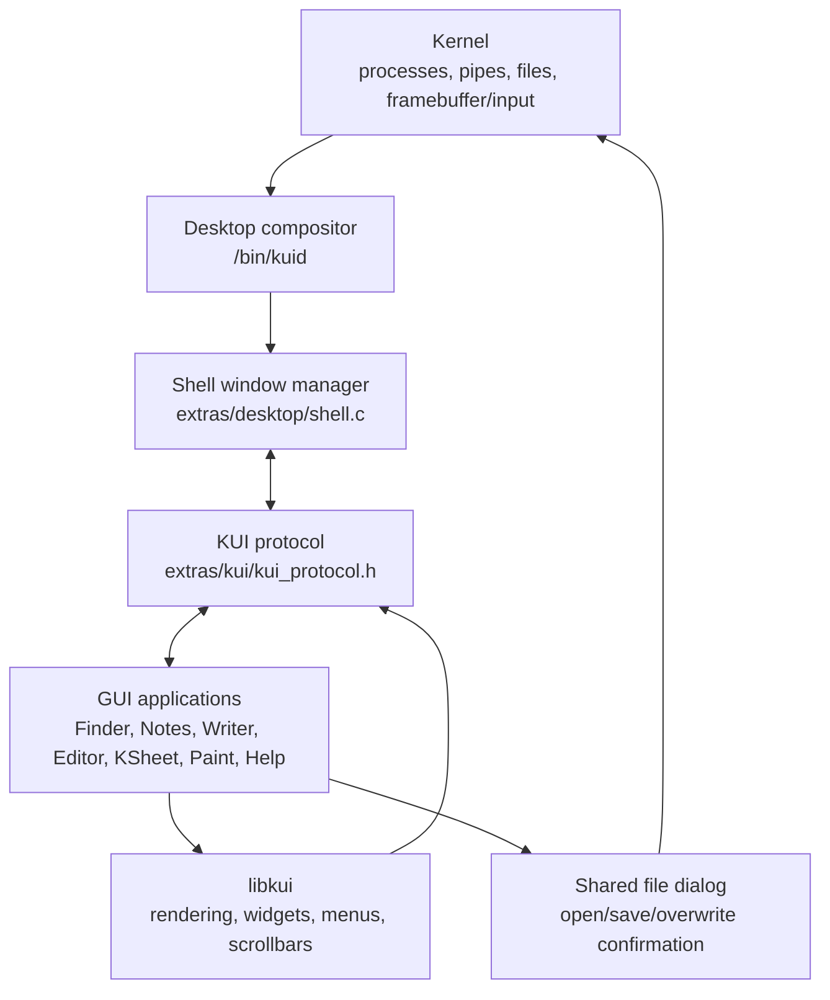
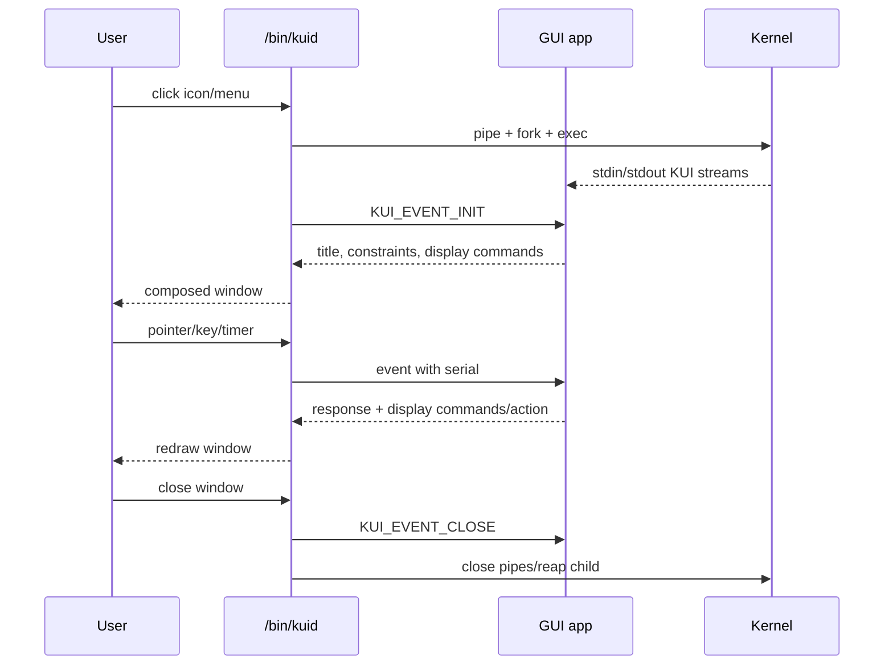
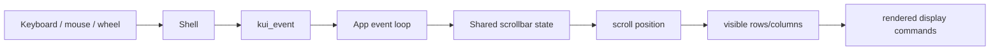
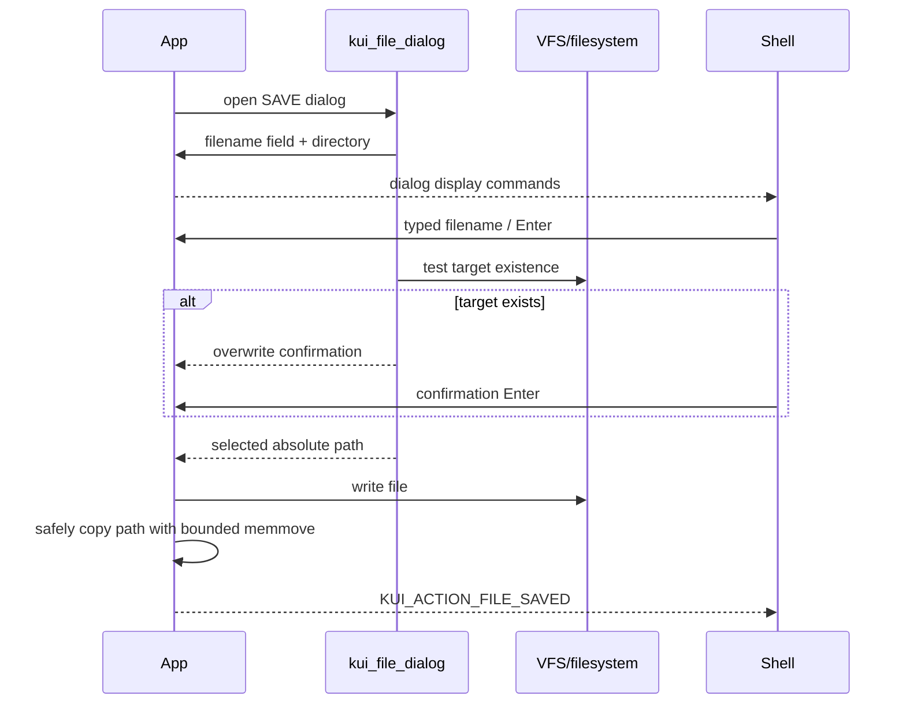

# KyleOS GUI Architecture

## System overview

The desktop owns the screen and application windows. Applications never draw
directly to the framebuffer. Each application receives a `kui_event`, builds a
display command buffer with libkui, and returns a `kui_response`.

## Application lifecycle

Once per desktop iteration, the compositor passes the shell response pipe and
every visible application's response pipe to one nonblocking `poll()` call.
`POLLHUP`, `POLLERR`, or `POLLNVAL` removes a disconnected window immediately.
After sending an event, bounded KUI response reads use `poll()` with the
remaining protocol deadline instead of repeatedly checking descriptor status.
Terminal uses the same API to drain command output without blocking its event
loop.

## Rendering pipeline

1. The shell creates a window-sized `kui_surface` command buffer.
2. The app records rectangles, text, lines, bitmaps, and scrollbar primitives.
3. `kui_client_send()` serializes the response and command buffer over stdout.
4. The shell validates the protocol serial and display size.
5. The shell replays commands into the window pixel buffer.
6. The compositor composites windows, menus, taskbar, and cursor into the frame.

The current display-command limit is 512 KiB (`KUI_PROTOCOL_MAX_DISPLAY`).
Text commands can request monospace or proportional glyphs, opacity, bold
stroke weight, and integer scaling from 1x through 4x. Writer uses these
validated command flags so styled text follows the same client/compositor path
as every other KUI primitive.

## Input and scrolling

Wheel movement is normalized by `kui_scrollbar_wheel()`. Arrow buttons use the
same scrollbar state and timer, with an initial delay followed by repeat ticks.

## Save As flow

Save operations use bounded overlap-safe path copies. The shell appends
lifecycle and protocol diagnostics to `/shell.log` without using stdout, which
is reserved for the KUI protocol.

## Main source locations

| Layer | Source |
|---|---|
| Desktop/window manager | `extras/desktop/shell.c` |
| Protocol definitions | `extras/kui/kui_protocol.h` |
| Rendering/widgets | `extras/kui/kui.c` and `extras/kui/*.c` |
| Shared file dialog | `extras/kui/kui_file_dialog.c` |
| KSheet | `extras/ksheet/ksheet.c` |
| Editor/CIDE | `extras/editor/editor.c`, `extras/cide/cide.c` |
| Notes | `extras/editor/editor.c` (`NOTES_APP`) |
| Writer/KWP documents | `extras/wordprocessor` |
| Terminal | `extras/terminal/terminal.c` |
| Help | `extras/help/help.c` |
